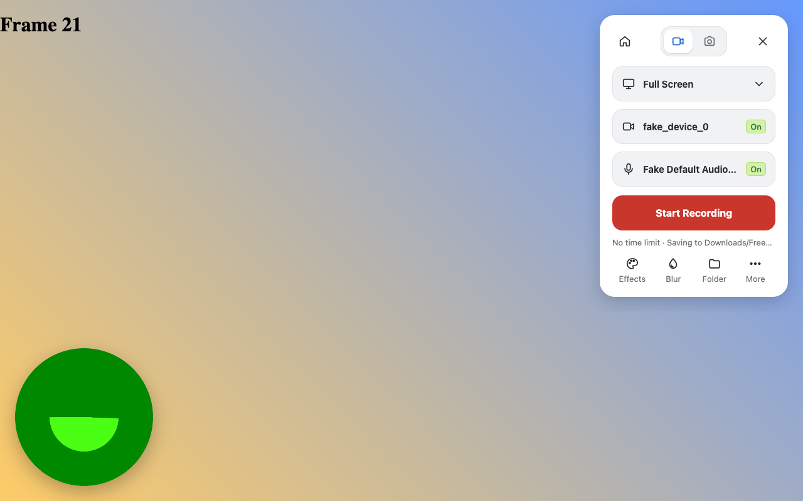
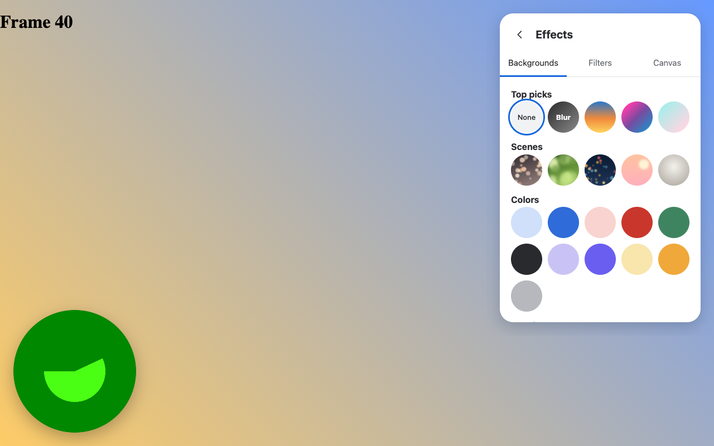
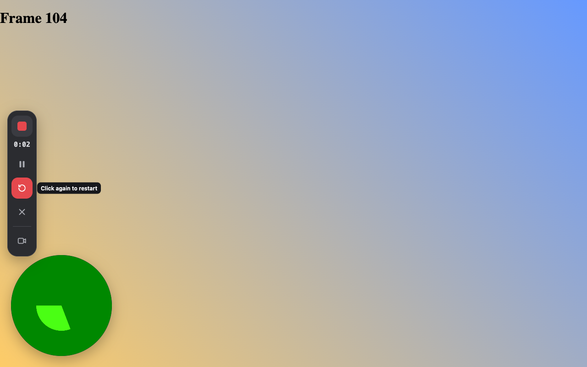
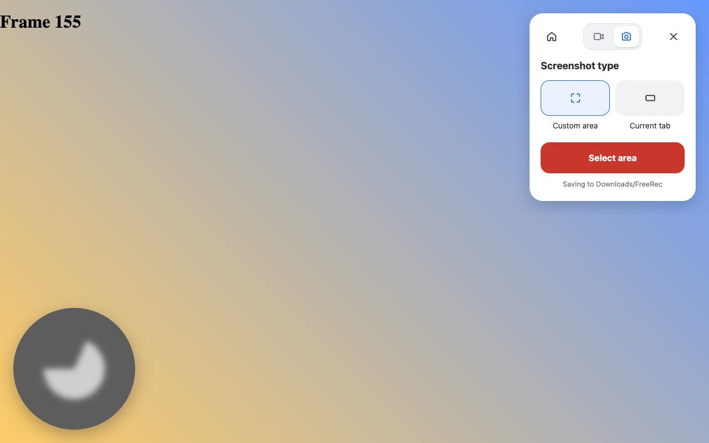
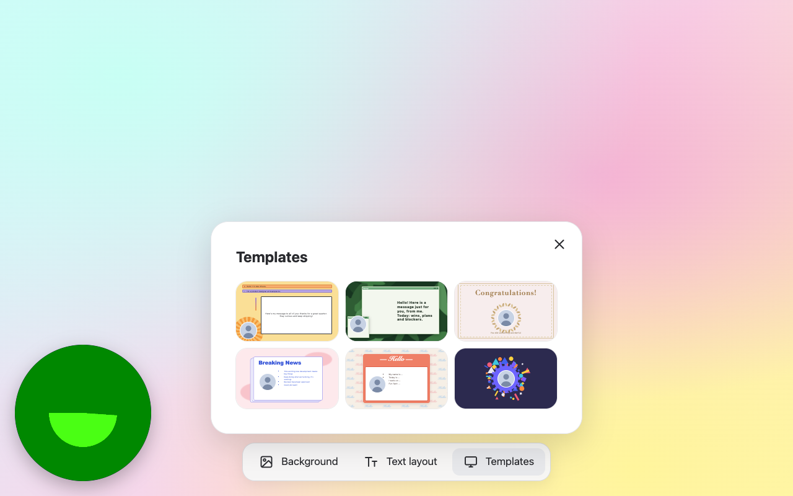
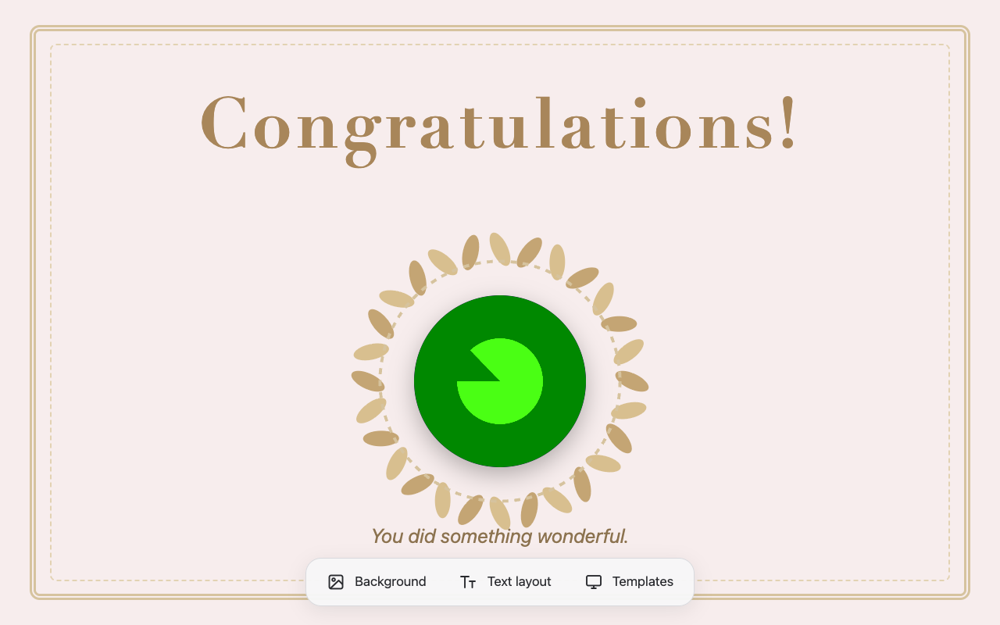

<div align="center">


# FreeRec

**A free, private screen and camera recorder for Google Chrome.**

Record your screen, a window or a tab with a camera bubble, background effects and
filters, present on a built-in canvas, or take screenshots. Everything is saved
straight to a folder on your computer. There's no account, no subscription and no
upload.


[](https://github.com/kowshik24/freerec/releases/latest)


</div>

---

## Table of contents

- [Highlights](#highlights)
- [Screenshots](#screenshots)
- [Requirements](#requirements)
- [Installation](#installation)
- [First-run setup](#first-run-setup)
- [Usage](#usage)
- [Settings reference](#settings-reference)
- [Where files are saved](#where-files-are-saved)
- [Architecture](#architecture)
- [Project structure](#project-structure)
- [Permissions](#permissions)
- [Privacy](#privacy)
- [Development](#development)
- [Troubleshooting](#troubleshooting)
- [Known limitations](#known-limitations)
- [Credits and third-party software](#credits-and-third-party-software)
- [License](#license)
- [Disclaimer](#disclaimer)

---

## Highlights

| | |
|---|---|
| **Free, no limits** | No account, no plan, no time limit, no watermark. |
| **Saves to your folder** | Pick any folder once. Each recording is streamed into it as you record. |
| **Four capture modes** | Full Screen, Window, Current tab (no picker) and Camera only. |
| **Camera bubble** | Round, draggable, resizable webcam overlay. It's captured in the video. |
| **Effects** | Background blur, virtual backgrounds (scenes, colours, your own image) and 10 colour filters, all on-device. |
| **Canvas** | A slide-like page with backgrounds, text layouts and 6 templates to present on. |
| **Recording controls** | 3-2-1 countdown, then pause/resume, restart, discard, finish and a camera toggle. |
| **Screenshots** | Capture a custom area or the whole visible tab as PNG. |
| **Library** | Browse, play, rename and delete your videos and screenshots. |
| **Proper files** | WebM (VP9/Opus) gets a real duration written into the header so players can seek. MP4 (H.264) is available where Chrome supports it. |
| **Private** | No network requests, no analytics. The segmentation model runs locally. |

## Screenshots

> Captured in Chrome's automated test mode, which uses a synthetic green test
> pattern in place of a real webcam.

| Control panel | Effects |
|---|---|
|  |  |

| Recording controls | Screenshot mode |
|---|---|
|  |  |

| Canvas templates | Canvas: Celebration template |
|---|---|
|  |  |

## Requirements

- **Google Chrome 116 or newer** on Windows, macOS, Linux or ChromeOS. Other
  Chromium browsers (Edge, Brave, Arc) should work but aren't tested.
- **macOS only:** Chrome needs the *Screen & System Audio Recording*
  permission. See [Troubleshooting](#troubleshooting).
- A webcam and microphone are optional.

## Installation

FreeRec isn't on the Chrome Web Store, so you install it as an **unpacked
extension**. It takes about a minute.

### Option A: from a release (recommended)

1. Go to **[Releases → Latest](https://github.com/kowshik24/freerec/releases/latest)**
   and download `freerec-<version>.zip` under *Assets*. A `.sha256` checksum is
   published next to it.
2. Unzip it. You get a folder called `freerec` with `manifest.json` inside.
3. Move that folder somewhere permanent, for example `Documents/freerec`.
   Chrome loads the extension from it, so don't delete or move it later.
4. Open **`chrome://extensions`** in Chrome.
5. Turn on **Developer mode** (switch in the top-right corner).
6. Click **Load unpacked** and select the `freerec` folder (the one that
   contains `manifest.json`).
7. FreeRec appears in the list and the setup page opens.
8. Optional: click the puzzle-piece icon in Chrome's toolbar and **pin**
   FreeRec.

### Option B: from source (git)

```bash
git clone https://github.com/kowshik24/freerec.git
```

Then follow steps 4–8 above and select the cloned `freerec` folder.

You can also use **Code → Download ZIP** on GitHub. Unzip it and load the
extracted folder (for example `freerec-main`).

### Updating

- **Zip install:** download the newest zip from
  [Releases](https://github.com/kowshik24/freerec/releases), replace the
  folder's contents, then click the **reload ↻** icon on FreeRec's card in
  `chrome://extensions`. See [CHANGELOG.md](CHANGELOG.md) for what changed.
- **Git install:** run `git pull` in the folder, then click **reload ↻**.

Your settings, chosen folder and recordings are kept.

### Uninstalling

Click **Remove** on FreeRec's card in `chrome://extensions`. Recordings you
saved to your folder stay on disk.

## First-run setup

The setup page (`options.html`) opens after installation. You can reopen it any
time from **More → Settings** in the panel.

1. **Camera & microphone:** click **Allow camera & microphone** and accept
   Chrome's prompt. This is needed for the camera bubble and voice-over.
2. **Save folder:** click **Choose folder…** and pick where recordings should
   go. If you skip this, files go to `Downloads/FreeRec/`.
3. **Defaults (optional):** countdown, video quality, file format, bubble
   size, and whether the recorder tab stays pinned.

## Usage

### Recording a video

1. Click the **FreeRec icon** in the toolbar, or press **`Alt+Shift+O`**. The
   control panel opens on the current page.
2. Choose what to record from the first row:
   - **Full Screen:** an entire display.
   - **Window:** a single application window.
   - **Current tab:** the tab you're on. There's no picker when you opened the
     panel from the toolbar icon.
   - **Camera only:** just your webcam, full frame.
3. Pick your **camera** and **microphone**, or tap their **On/Off** pill.
4. Optional: open **Effects** or tap **Blur** (see below).
5. Click **Start Recording**. If Chrome shows its share dialog, pick what to
   share. Tick **Share audio** to include tab or system sound.
6. A **3 · 2 · 1** countdown appears. Press **`Esc`** to cancel.
7. Recording starts. Use the vertical **control bar** on the left:

   | Control | Action |
   |---|---|
   | ■ | Finish and save |
   | `0:42` | Elapsed time (pauses excluded) |
   | ❚❚ / ▶ | Pause / resume |
   | ↻ | Restart. Discards the take and counts down again (click twice to confirm). |
   | ✕ | Discard (click twice to confirm) |
   | 🎥 | Show or hide the camera bubble |

8. When you finish, **My recordings** opens and plays the new video.

Drag the control bar or the camera bubble anywhere on the page. Hover the
bubble and use its resize button to cycle Small → Medium → Large. The bubble
follows you as you switch tabs.

### Effects

Open **Effects** from the panel footer. Effects apply to the camera bubble.

- **Backgrounds:** None, Blur, three gradients, five scenes (Bokeh, Leaves,
  City, Dawn, Studio), 11 solid colours, or **upload your own image**.
- **Filters:** None, Pop, Mono, Golden, Soft, Ember, Tide, Film, Bold,
  Vintage. Previews use a live snapshot of your camera.
- **Canvas:** shortcuts to the Canvas templates and backgrounds.

Background effects use an on-device person-segmentation model. It loads the
first time you pick a background, which takes about 1–2 s.

### Canvas

Canvas (`canvas.html`) is a full-page stage to present on with your camera
bubble. Open it from **Effects → Canvas** or from the Canvas icon in the
library. Clicking FreeRec on a page where the panel can't run, such as
`chrome://` pages, also opens it.

The toolbar at the bottom has:

- **Background:** 8 colour swatches, a custom colour (**+**), and six image
  backgrounds (Pastel, Rainbow, Paint, Lagoon, Dashes, Floral).
- **Text layout:** Blank, Say hello, Big idea (top), Big idea (left), Bullet
  points, Pros and cons.
- **Templates:** Meeting, Standup, Celebration, News, Intro, Bubble. Each
  template also moves the camera bubble into its slot.

Click any text on the page to edit it. Edits are remembered for each layout and
template. The toolbar hides automatically while you record. Choose **Current
tab** to record the canvas.

### Screenshots

1. Open the panel and click the **camera icon** in the header toggle.
2. Choose **Custom area** (drag a rectangle; `Esc` cancels) or **Current tab**.
3. Click **Select area** or **Take screenshot**. A toast confirms the save
   and links to it.

FreeRec's own UI is hidden during capture, so it never appears in the image.

### Library

**My recordings** (`library.html`, or the **Home** icon in the panel) shows
your save folder:

- **Videos** and **Screenshots** tabs
- Search by name and sort (newest, oldest, largest, A–Z)
- Click a card to play or view it. Each card has **Rename** and **Delete**.
- **Change folder** to point FreeRec at a different folder.

### Keyboard shortcuts

| Shortcut | Action |
|---|---|
| `Alt+Shift+O` | Open / close the panel |
| `Alt+Shift+X` | Finish and save |
| `Alt+Shift+P` | Pause / resume |
| `Alt+Shift+C` | Discard the recording |
| `Esc` | Cancel the countdown, close the panel or a menu |

You can change these at `chrome://extensions/shortcuts`.

## Settings reference

| Setting | Options | Default | Where |
|---|---|---|---|
| Recording source | Full Screen · Window · Current tab · Camera only | Full Screen | Panel |
| Camera | Any connected camera · No Camera | First camera, on | Panel |
| Microphone | Any connected mic · No Microphone | Default mic, on | Panel |
| Video quality | 720p · 1080p · 1440p · 4K | 1080p | Settings |
| File format | WebM (VP9 + Opus) · MP4 (H.264 + AAC)¹ | WebM | Settings |
| Countdown | On · Off | On | Settings |
| Bubble size | Small · Medium · Large | Medium | Settings / bubble |
| Keep recorder tab pinned | On · Off | On | Settings |
| Panel theme | Light · Dark | Light | Panel → More |

¹ MP4 shows only when Chrome's `MediaRecorder` supports it.

Target bitrates: 720p 2.5 Mbps · 1080p 5 Mbps · 1440p 8 Mbps · 4K 16 Mbps
(video), 128 kbps (audio). Capture is capped at 30 fps.

## Where files are saved

| Situation | Location | Name |
|---|---|---|
| Folder chosen | Your folder | `FreeRec 2026-10-20 at 14.05.33.webm` |
| No folder chosen | `Downloads/FreeRec/` | same pattern |
| Screenshots | Same as above | `Screenshot 2026-10-20 at 14.05.33.png` |

- In folder mode the video is **written to disk while you record** in 1-second
  chunks, so long recordings don't use up memory.
- Chrome may ask you to confirm folder access again after a browser restart.
  FreeRec shows an **Allow** button when that happens. Keeping the recorder tab
  pinned avoids most re-prompts.
- In Downloads mode the file is streamed into the extension's private storage
  and handed to Chrome's downloader when you finish. If that hand-off fails,
  the file stays under **My recordings → Stored in browser**.

## Architecture

FreeRec is a Manifest V3 extension written in plain JavaScript (ES modules), with
no framework and no build step.

```
                       ┌──────────────────────────────────────────┐
  toolbar icon ───────▶│ background.js  (service worker)          │
  shortcuts            │ • injects content.js, opens the panel    │
                       │ • starts/finds the recorder tab          │
                       │ • captureVisibleTab for screenshots      │
                       │ • badge (REC / ❚❚), overlay re-injection │
                       └───────────────┬──────────────────────────┘
                                       │ runtime messages
        ┌──────────────────────────────┼─────────────────────────────┐
        ▼                              ▼                             ▼
┌───────────────────┐      ┌─────────────────────────┐   ┌─────────────────────┐
│ content.js        │      │ recorder.html / .js     │   │ library / options / │
│ (in the web page) │      │ (pinned tab)            │   │ canvas pages        │
│ • panel iframe ───┼─┐    │ • desktopCapture /      │   └─────────────────────┘
│ • camera bubble ──┼┐│    │   tabCapture / camera   │
│ • control bar     │││    │ • mic + system audio mix│
│ • countdown       │││    │ • MediaRecorder         │
│ • area picker     │││    │ • File System Access    │
└───────────────────┘││    │   streaming writer      │
                     ││    │ • WebM duration patch   │
   camera.html ◀─────┘│    └─────────────────────────┘
   (effects, MediaPipe)│
   panel.html ◀────────┘
```

### Recording pipeline

1. **Start.** The panel sends `start` to the service worker, which makes sure
   the recorder tab exists (pinned, in the background) and forwards the request
   with the originating tab's ID.
2. **Prepare.** The recorder:
   - checks folder permission (and asks if needed)
   - opens the microphone
   - checks camera permission for the bubble
   - acquires the video source:
     - **Current tab:** `chrome.tabCapture.getMediaStreamId`, with no picker.
       Tab audio is played back so you can still hear it.
     - **Screen / Window:** `chrome.desktopCapture.chooseDesktopMedia` +
       `getUserMedia({ chromeMediaSource: 'desktop' })`.
     - **Camera only:** `getUserMedia` on the selected camera.

   The recorder tab only comes to the front when it needs a click or Chrome's
   picker, then returns you to your page.
3. **Mix.** If there's both system/tab audio and a mic, they're merged through
   an `AudioContext` into one track.
4. **Countdown.** State `countdown` with an end time goes to
   `chrome.storage`. Every overlay renders the same 3-2-1 from it.
5. **Record.** `MediaRecorder` (VP9 → VP8 fallback, or H.264) emits 1-second
   chunks. They're written sequentially to a `FileSystemWritableFileStream`.
6. **WebM duration.** `MediaRecorder` WebM has no `Duration` element.
   `lib/webm.js` inserts an 8-byte placeholder into the Segment Info of the
   first chunk and remembers its file offset. On finish it overwrites that
   value in place, with no re-copy of the file.
7. **Finish.** The writer closes, the file is exported to Downloads if needed,
   and the library opens on the new file.

### Camera effects

`camera.html` runs inside the bubble iframe. `lib/effects.js` draws every video
frame to a canvas:

- **Filter:** CSS `ctx.filter` strings (see `lib/catalog.js`).
- **Background:** MediaPipe Selfie Segmenter (`ImageSegmenter`, VIDEO mode,
  GPU with CPU fallback). It produces a confidence mask that becomes an alpha
  mask, feathered with a 2 px blur. The person layer is composited over a
  blurred frame, a cached procedural scene, a solid colour or your image.

The panel previews filters with snapshots sent from the bubble over a
`BroadcastChannel`.

### State

| Store | Key | Contents |
|---|---|---|
| `chrome.storage.local` | `settings` | Source, devices, quality, format, countdown, theme… |
| | `effects` | `{ filter, background }` |
| | `rec` | Live recording state (`idle` / `preparing` / `countdown` / `recording` / `paused` / `saving`, timestamps) |
| | `overlayPrefs` | Bubble position/size, camera hidden |
| | `folderName`, `customBg`, `recent` | Folder label, uploaded background, recent saves |
| IndexedDB `freerec` | `dirHandle` | The chosen `FileSystemDirectoryHandle` |
| `localStorage` (canvas page) | `freerec-canvas` | Canvas background, layout, template and edited text |

Every UI surface (panel, overlay, badge, recorder page) re-renders from
`chrome.storage.onChanged`, so they stay in sync across tabs.

## Project structure

```
freerec/
├── manifest.json            Extension manifest (MV3)
├── background.js            Service worker: panel, recorder tab, screenshots, badge
├── content.js               On-page UI: panel iframe, bubble, control bar, countdown, area picker
├── panel.html/.css/.js      Control panel (record, screenshot, effects views)
├── camera.html/.js          Camera bubble with live effects
├── recorder.html/.js        Capture, mixing, MediaRecorder, file writing, screenshots
├── canvas.html/.js          Canvas page (backgrounds, text layouts, templates)
├── stage.css                Canvas stage styles (container units, shared with thumbnails)
├── library.html/.js         Recordings & screenshots browser
├── options.html/.js         Setup and settings
├── ui.css                   Shared tokens for library, options and recorder pages
├── lib/
│   ├── store.js             Settings, effects, IndexedDB folder handle, helpers
│   ├── webm.js              WebM Duration placeholder + in-place patch
│   ├── effects.js           Filter + segmentation renderer
│   ├── catalog.js           Filter definitions and procedural backgrounds
│   ├── stage.js             Canvas backgrounds, layouts, templates, renderer
│   └── icons.js             Inline SVG icon set
├── vendor/mediapipe/        MediaPipe Tasks Vision 0.10.14 + selfie_segmenter.tflite
├── icons/                   Toolbar / store icons
├── docs/screenshots/        README images
├── .github/workflows/       Release workflow (builds and publishes the zip on tags)
├── CHANGELOG.md             Version history, used for release notes
└── dist/                    Local build output (git-ignored)
```

## Permissions

| Permission | Why it's needed |
|---|---|
| `desktopCapture` | Show Chrome's screen/window/tab picker |
| `tabCapture` | Record the current tab without a picker |
| `scripting`, `activeTab` | Inject the panel and overlay into the page |
| `host_permissions: <all_urls>` | Keep the camera bubble and controls on every tab you switch to while recording, and capture screenshots |
| `storage`, `unlimitedStorage` | Settings, and buffering recordings when saving to Downloads |
| `downloads` | Save to `Downloads/FreeRec` when no folder is chosen |

The extension pages' CSP is `script-src 'self' 'wasm-unsafe-eval'`. The
`wasm-unsafe-eval` part is only there so the bundled MediaPipe WebAssembly can
compile. No remote code is loaded.

## Privacy

- **No network access.** FreeRec makes no requests. All code, the WASM runtime
  and the ML model are bundled.
- **No accounts, telemetry or analytics.**
- Recordings and screenshots exist only in the folder you choose (or your
  Downloads folder).
- Camera and microphone are used only while the panel, bubble or a recording is
  active.

## Development

There's nothing to compile or install.

1. Clone the repo and load it with **Load unpacked** (see
   [Installation](#installation)).
2. Edit the files.
3. Apply your changes:
   - **Service worker or manifest:** click **reload ↻** on the extension card.
   - **Panel, recorder, library, options or canvas:** reload that page or tab.
   - **Content script:** reload the extension, then reload the web page.

### Debugging

| Component | How to inspect |
|---|---|
| Service worker | `chrome://extensions` → FreeRec → *service worker* link |
| Recorder | Open the pinned **FreeRec Recorder** tab → DevTools |
| Panel / bubble | DevTools on the page → frame selector → `panel.html` / `camera.html` |
| Storage | DevTools → Application → Extension storage / IndexedDB `freerec` |

### Releasing

Releases are automated by [`.github/workflows/release.yml`](.github/workflows/release.yml):

1. Bump `"version"` in `manifest.json`.
2. Add a `## [x.y.z] - YYYY-MM-DD` section to [CHANGELOG.md](CHANGELOG.md).
3. Commit, then tag and push:

   ```bash
   git tag v1.2.0
   git push origin main v1.2.0
   ```

The workflow checks the tag matches the manifest version and validates the
sources. It then builds `freerec-<version>.zip` plus a SHA-256 checksum and
publishes a GitHub Release, using that version's changelog section as the
notes.

### Packaging locally

From the repository root:

```bash
VERSION=$(grep -o '"version": "[^"]*' manifest.json | cut -d'"' -f4)
OUT="$PWD/dist/freerec-$VERSION.zip"
mkdir -p dist /tmp/freerec-pkg/freerec && rm -f "$OUT"
rsync -a --exclude .git --exclude dist --exclude docs --exclude .DS_Store ./ /tmp/freerec-pkg/freerec/
(cd /tmp/freerec-pkg && zip -qr "$OUT" freerec)
rm -rf /tmp/freerec-pkg
echo "Built $OUT"
```

### Automated testing tips

Chrome for Testing can drive the full flow headlessly with these flags:

```
--use-fake-ui-for-media-stream            # auto-accept camera/mic prompts
--use-fake-device-for-media-stream        # synthetic camera + mic
--auto-select-desktop-capture-source=TITLE  # auto-pick the tab/window with this title
--window-size=1280,900                    # real window size, needed for clicks into iframes
```

Load the extension with Puppeteer's `enableExtensions: [path]` and `pipe: true`.
Use **Save to Downloads instead** at the folder prompt, because the native
folder picker can't be automated.

### Manual QA checklist

- [ ] Panel opens on a normal site, and on `chrome://newtab` (Canvas fallback)
- [ ] Each source: Full Screen, Window, Current tab, Camera only
- [ ] Countdown shows 3 · 2 · 1 and `Esc` cancels it
- [ ] Pause/resume, restart, discard and finish from the control bar and the shortcuts
- [ ] The saved file plays, shows the right duration and can seek
- [ ] Blur, a scene, a colour, an uploaded image and a filter all show on the bubble
- [ ] Custom-area and current-tab screenshots are saved
- [ ] The library lists, plays, renames and deletes files
- [ ] After a browser restart, the folder permission re-prompt works

## Troubleshooting

<details>
<summary><b>The share dialog shows a black screen or no screens (macOS)</b></summary>

Open **System Settings → Privacy & Security → Screen & System Audio Recording**,
enable **Google Chrome**, then quit and reopen Chrome.
</details>

<details>
<summary><b>"Camera blocked" in the bubble</b></summary>

Open FreeRec's **Settings** and click **Allow camera & microphone**. If it shows
*blocked*, click the camera icon in the address bar of the Settings tab and
allow access. A few sites forbid embedded cameras through their security
policy. Use **Current tab** on the Canvas page instead.
</details>

<details>
<summary><b>Clicking the icon does nothing / no panel appears</b></summary>

Chrome doesn't allow extensions on `chrome://` pages, the Web Store or some
built-in viewers. FreeRec opens the Canvas page there instead. On normal sites,
reload the page once after installing or updating the extension.
</details>

<details>
<summary><b>"FreeRec needs your OK to save into …"</b></summary>

Chrome resets folder access after a restart. Click **Allow** in the recorder
tab, or pick another folder. Keep the recorder tab pinned to avoid repeat
prompts.
</details>

<details>
<summary><b>No system audio in a Full Screen recording</b></summary>

On macOS, Chrome can't capture system audio for a whole screen. Use **Current
tab** or pick a tab in the share dialog with **Share audio** ticked.
</details>

<details>
<summary><b>The video won't seek in some players</b></summary>

WebM files get a duration but no seek index (Cues), which is normal for
browser recordings. Most players (Chrome, VLC, mpv) seek fine. For maximum
compatibility, choose **MP4** in Settings.
</details>

## Known limitations

- Effects apply to the camera bubble. **Camera only** recordings are the
  plain camera, as in most screen recorders.
- The bubble is part of the page. When recording another app's window or a
  whole screen, it appears only while a Chrome tab showing it is visible.
- The pinned recorder tab must stay open during a recording. Closing it ends
  the recording, and the partial file may be lost.
- `Current tab` without a picker needs the panel to have been opened from the
  toolbar icon on that tab. Otherwise Chrome's picker is shown.
- Unpacked extensions show a "Developer mode" notice in some Chrome versions.

## Credits and third-party software

- **[MediaPipe Tasks Vision](https://developers.google.com/mediapipe)** 0.10.14
  and the **Selfie Segmenter** model, © Google LLC, licensed under the
  [Apache License 2.0](https://www.apache.org/licenses/LICENSE-2.0). See
  `vendor/mediapipe/NOTICE.txt`.
- The icons, backgrounds, canvas templates and UI are original work for this
  project.

## License

FreeRec is released under the [MIT License](LICENSE). You're free to use, modify
and redistribute it, including commercially, as long as the copyright notice is
kept.

The bundled MediaPipe files in `vendor/mediapipe/` stay under their own
[Apache License 2.0](https://www.apache.org/licenses/LICENSE-2.0).

## Disclaimer

FreeRec is an independent open project. It isn't affiliated with, endorsed by
or connected to Loom, Atlassian or Google. All product names are trademarks of
their respective owners.
